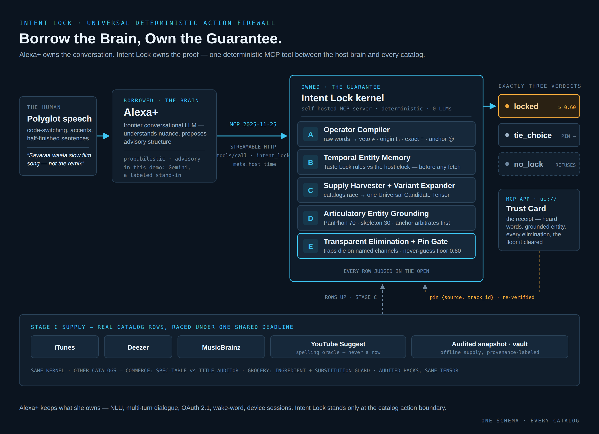
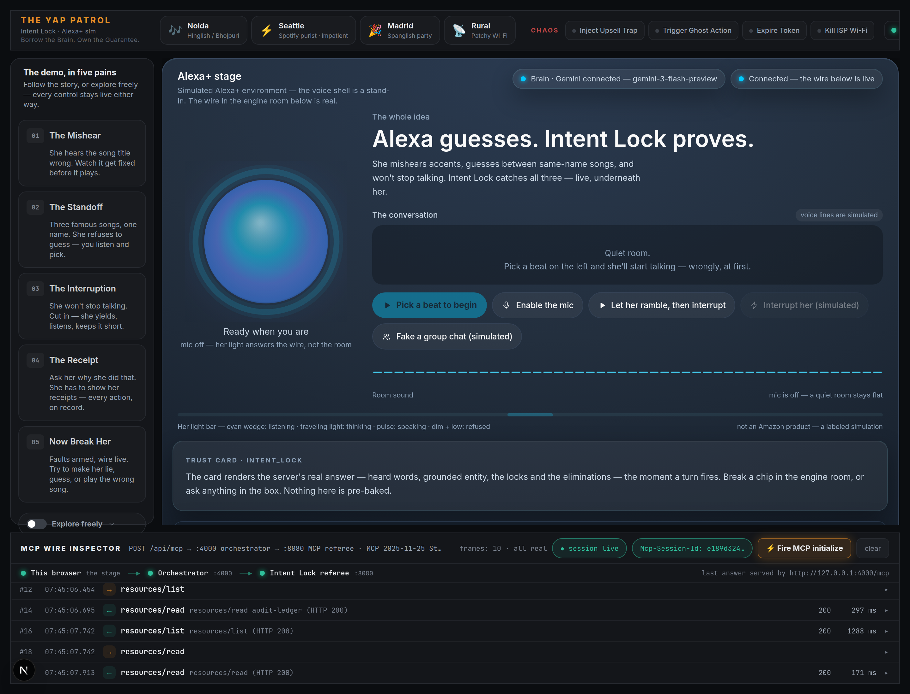
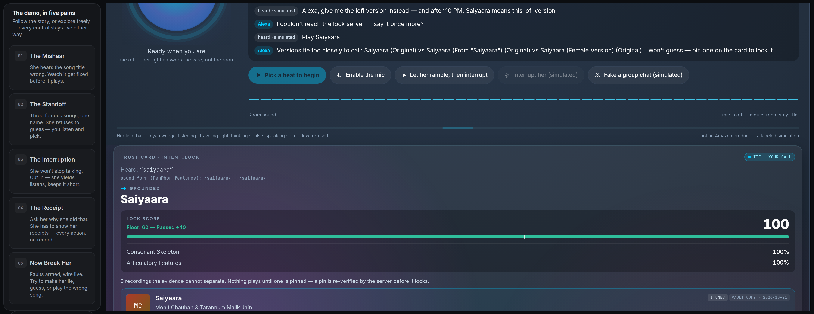
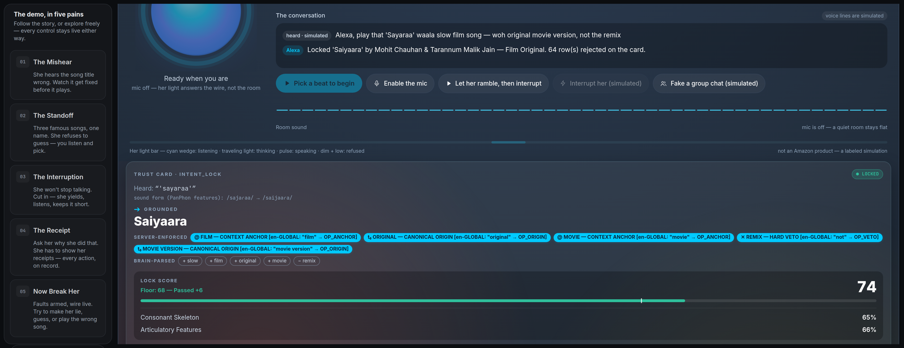
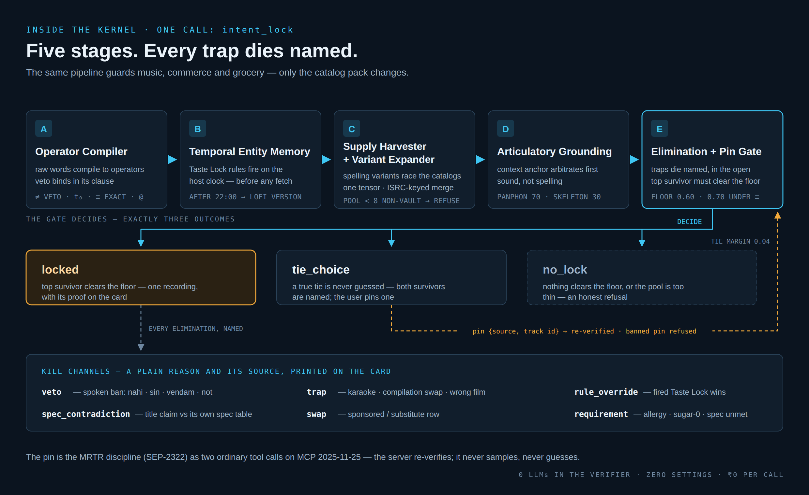

# Intent Lock

**Borrow the Brain, Own the Guarantee.**

[](LICENSE)
[](docs/MCP_PROTOCOL_PROOF.md)


Modern voice assistants understand us brilliantly. Alexa+ hears nuance,
code-switching, half-finished sentences — the conversation is hers, and
she is excellent at it. The trouble starts one step later, when that
understanding reaches into a real catalog: a wall of remixes, karaoke
knock-offs, same-name films and spec-lying substitutes, where one wrong
row is what actually plays, ships, or gets ordered.

Intent Lock is the fence at exactly that boundary. It is a single
deterministic MCP tool — no LLM inside, nothing probabilistic — that
sits between any host brain and any catalog, and refuses to act until
the request is *proven* against the user's own words: what they asked
for, what they banned, which version, which artist, which film. The
host proposes; Intent Lock verifies, eliminates every row that breaks
the user's stated intent in the open, and only then locks.

**Alexa guesses. Intent Lock proves.**



*The whole system on one plate: the borrowed brain on the left, the owned guarantee in the middle, real catalog supply underneath, and exactly three verdicts on the right.*



## Gallery

| The tie, told honestly | The lock, with proof |
| --- | --- |
|  |  |
| Two films share one name, so nothing is crowned by guesswork — the card asks, the user taps, the server re-verifies the pin against every ban. | One recording survives. Its score, the floor it cleared, and every eliminated trap are on the card — the trap that *almost* happened is the explanation. |

## Quickstart

Zero settings, no Docker, no keys required:

```bash
git clone https://github.com/AdityaPagare619/intent-lock.git
cd intent-lock
make demo
```

Then open **http://localhost:3000** and click a beat. The demo is the
Alexa+ simulator stage: Gemini plays the host brain (extraction only),
and every catalog decision is made by the Intent Lock MCP server.

- **Windows:** native PowerShell launchers — see
  [docs/INSTALL_WINDOWS.md](docs/INSTALL_WINDOWS.md).
- **macOS:** see [docs/INSTALL_MACOS.md](docs/INSTALL_MACOS.md).
- With no Gemini key set, the demo still boots and locks: extraction
  falls back to a deterministic local floor over the audited catalog
  snapshot, and the UI labels the fallback honestly.

## How it works

One tool, `intent_lock`, over MCP **2025-11-25** (Streamable HTTP).
Inside, a five-stage deterministic kernel:

1. **Operator Compiler** — the user's own words compile into operators:
   vetoes ("nahi", "sin", "vendam", "not"), origin demands ("asli",
   "original"), exact-only demands, and anchors — scoped to the clause
   they were spoken in.
2. **Temporal Entity Memory** — standing preferences ("after 10 PM,
   Saiyaara means the lofi version") and the host's clock are
   evaluated *before* anything is fetched. An explicit ask tonight
   outranks a standing rule; a rule a host invented is never stored.
3. **Supply Harvester + Variant Expander** — iTunes, MusicBrainz,
   Deezer and an audited offline snapshot race under one deadline and
   merge into a single candidate tensor (ISRC-keyed), so degraded
   supply degrades the pool — never the standards.
4. **Articulatory Entity Grounding** — names are grounded by how they
   are pronounced (PanPhon articulatory distance + consonant
   skeleton), so "Sayaraa" finds Saiyaara and a film anchor settles
   which family a name belongs to before any scoring.
5. **Transparent Elimination & Pin Gate** — every row is eliminated in
   the open, with its kill reason, or survives. A lock must clear a
   typed 0.60 floor on evidence — a score gap, a named artist, a
   spoken anchor, multi-source attestation. Two genuinely tied
   recordings are never crowned by pool order: the answer is
   `tie_choice`, the user pins, the server re-verifies the pin.

Music is the worked example, not the product: the same kernel guards a
commerce pack (a cable's title claims are audited against its own spec
table) and a grocery pack (an allergy veto and a sugar-0 requirement
are enforced over product data, not tag strings).



*Inside the kernel: every eliminated row dies on a named channel, and a tie is settled by a pin the server re-verifies — never by a guess.*

## What Intent Lock is not

Alexa+ keeps what she owns — natural language understanding, multi-turn
dialogue, OAuth 2.1, wake-word detection and barge-in, device sessions.
Intent Lock rebuilds none of it and claims none of it. It is one tool
call (plus a re-verified `pin` re-call after an honest tie) standing at
exactly one place: the catalog action boundary, where a brilliant
understanding meets rows it cannot trust.

Full spec: [docs/12_INTENT_LOCK_SPEC.md](docs/12_INTENT_LOCK_SPEC.md) ·
Architecture: [docs/ARCHITECTURE_V2.md](docs/ARCHITECTURE_V2.md) ·
Protocol proof: [docs/MCP_PROTOCOL_PROOF.md](docs/MCP_PROTOCOL_PROOF.md) ·
In plain words: [docs/PLAIN_WORDS.md](docs/PLAIN_WORDS.md)

## The walkthrough

The guided Story — seven beats, the wire at the center, every number sourced — is a static page with no backend: [`docs/index.html`](docs/index.html). Open it from any clone; it runs the full guided walkthrough offline.

## Verify it yourself

```bash
bash scripts/bootstrap.sh   # one-time environment setup
bash scripts/demo-up.sh     # boot the stack — simulator :3000, orchestrator :4000, MCP server :8080
```

Then open http://localhost:3000 and run the beats — or point any MCP
client at http://127.0.0.1:8080/mcp and call `intent_lock` yourself.
A third-party client works: the server was locked end-to-end through
the official MCP Inspector, an unmodified stranger client
(tools/list → tie_choice → pin → locked).

## Testing, honestly

We attacked the kernel with three Gemini host personas — careful,
careless, and sloppy — across 55 messy utterances: 161 runs where the
host, not a script, chose the words. Before the fix wave that followed,
the guarantee survived **77.6%** of runs. The safety machinery never
broke — zero missed vetoes, zero smuggled pins in any run; every
failure was a *crowning* choice among legitimate rows. The crowning
layer is what the fix wave rebuilt — and the identical attacks,
replayed against the fixed kernel, came back **36 of 36 fixed:
survival 100.0%**, measured by the final acceptance gate on this
exact tree. Full methodology and the gate table:
[docs/TESTING.md](docs/TESTING.md). What the system still cannot do is printed,
not buried: see **Known limitations** in
[docs/DEVPOST_STORY.md](docs/DEVPOST_STORY.md).

## Project layout

```
apps/alexa-plus-simulator/    the stage: Alexa+ simulator + Trust Card UI
services/omnibeat-mcp-server/ the Intent Lock MCP server (the hero)
services/alexa-agent-orchestrator/  host-side orchestrator (Gemini brain, advisory only)
services/chaos-and-provider-mock/   fault-injection rig for the outage act
packages/polyglot-phonetic-judo/    the phonetic grounding library (also standalone, MIT)
scripts/                      launchers, wire suite, gate, host-matrix harness
docs/                         spec, architecture, friction log, submission packet
```

Built for the Amazon "Build, Ship, Shape" Developer Hackathon,
Alexa+ track, by **The Yap Patrol**. The Developer Friction Log —
every real platform papercut, measured — is in
[docs/FRICTION_LOG.md](docs/FRICTION_LOG.md).

## License

MIT — see [LICENSE](LICENSE).
